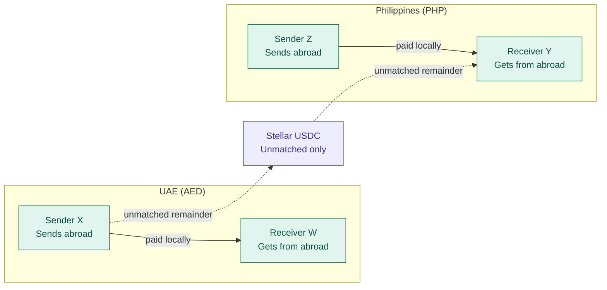
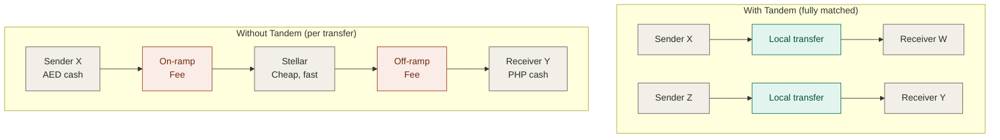

# Tandem

**Send together, save together.**
Tandem matches cross-border transfers in opposing directions so remittances stop paying to cross a border it never needed to cross. Built on Stellar.

Tandem is a peer-to-peer remittance app that lowers fees and makes cross-border transfers more accessible by matching opposite transfers (like CAD to KES and KES to CAD), paying each out domestically, and sending only the unmatched remainder across the border as USDC on Stellar.

---

## The problem

Moving money on the Stellar network is already fast and cheap. The minimum fee is 100 stroops (0.00001 XLM) per operation, and ledgers close in about 5 seconds.

The real hurdle is everything around it:

- **Accessibility.** Using blockchain to send money still means setting up wallets and learning crypto tooling.
- **Conversion costs.** The sender pays to convert cash into transferable coins, and the recipient pays again to convert those coins back into usable cash.

These costs fall hardest on people who send small amounts often. These costs fall hardest on people who send small amounts often. Our launch corridor is the UAE and the Philippines. The UAE is home to roughly 975,000 Filipinos, and it accounts for about 4.6% of the cash remittances sent to the Philippines, out of $35.63 billion in 2025, or 7.3% of the country’s GDP. That works out to roughly $1.6 billion a year from the UAE alone, and UAE cash remittances were up 4.3% year on year in the first half of 2026.

---

## How Tandem works

### 1. Invisible wallet (accessibility)

- Senders never create a crypto wallet.
- They log in with the anchor they already use, such as a bank or M-PESA.
- Funds stay in the sender's account and are not converted to crypto until they need to be, which keeps fees down.

### 2. Bidirectional matching (lower ramping costs)

1. A sender chooses to send an international transfer and sets a timer for how long Tandem should look for a match.
2. While the timer runs, the algorithm continuously checks the orders submitted between the two countries.
3. It checks in order of submission, so older orders are filled first.
4. It looks for transfers going in the opposite direction between the same countries.
5. If it finds one, the two transfers are fully or partially matched.
6. The matched amount is **not** sent internationally. It is paid out domestically through the sender's and receiver's chosen anchors.
7. The unmatched amount crosses the border over the Stellar network.

*Solid arrows are matched amounts, paid out locally with no crypto involved. Dotted arrows are the unmatched remainder, which crosses the border on Stellar. In this example the remainder flows toward Y, but it would flow in whichever direction is larger.*

### 3. Tridirectional+ matching (lower ramping costs)

Matching is not limited to two people. Say sender X in country A wants to pay Y in country B, while another person in country B (Y2) wants to pay Z. Instead of each leg being converted from cash to crypto and back to cash in every country, the algorithm looks for matches across the chain. It can route crypto from X straight to Z, fully or partially, and any unmatched amount goes through the regular routing described above.

### 4. Anchors near me (accessibility)

After receiving their unmatched crypto and matched e-transfer or cash, recipients can log in and see location-based suggestions for where to convert their digital funds into cash if they need to.

### Other features

- Transaction history with transparency on how each transfer was routed
- A dashboard of all transactions

---

## What this saves

Without matching, every transfer pays to convert cash into USDC at one end and back into cash at the other. With matching, matched amounts skip both conversions and the border crossing entirely.

Two opposite transfers without Tandem cost four conversion fees and two border crossings. With a full match, there are no conversion fees and no border crossing, only local transfer fees.

### Best, middle, and worst case

| Case | What happens |
| --- | --- |
| **Worst case (same as before)** | No matches, which is likely in heavily one-directional corridors. The transfer goes through regular transfer services chosen by the sender. |
| **Middle case (partial savings)** | A partial match saves crypto conversion fees on the matched part. The remainder is sent at regular domestic e-transfer or bank transfer rates, based on the anchor the user chooses. |
| **Best case (full savings)** | A full match means the international transfer is supported entirely by domestic transfers, with cheaper domestic fees. |

---

## Outcomes

- Reduced cash-to-crypto conversion costs
- Less illiquidity, since fewer people ask agents and anchors to convert crypto into cash
- Better access to Stellar's cost and speed benefits

---

## Business model

Tandem works best at scale, because more transfers in both directions means more matches. Businesses that send large, frequent batches in both directions of a corridor add volume to both sides. That lets more retail transfers be matched instantly, with no cross-border settlement or FX conversion.

- **Staying funded.** We sell first to money transfer operators (MTOs) and agencies, as an aggregator and netting layer. They already have customers and licenses, so we skip retail acquisition costs. A small per-transaction or SaaS fee brings in revenue from the first deal, and a few anchor clients can cover our runway.
- **How users benefit.** Lower fees, better exchange rates, and faster transfers, with no crypto wallet required. Every new user, in either direction, improves matching for everyone else.
- **How agencies and anchors benefit.** They cut pre-funding and FX costs and improve their liquidity. They can pass the savings on as cheaper transfers or earn a share of the fees, and they keep their brand and customers. In return, they provide transaction volume, local payout, and compliance coverage.

## Future features and opportunities

- **Tandem as an API.** We plan to turn the matching engine into an API, so any MTO, agency, or app can plug Tandem into its existing transfer flow instead of switching platforms.
- **Partnerships with financial services that already offer transfers.** Banks, fintechs, and mobile money providers already have the customers and transfer features. By building on what they offer, we add matching without asking users to change how they send money, and every partner adds volume that improves matches for everyone.
- **Multi-agency matching.** Matching is best when several transfer agencies use it together, so we will partner with or sell the platform to agencies and add crypto exchange as a new, lower-fee service built for the community.
- **Anchor integrations.** Anchors can link user accounts so people can quickly convert between digital currency and cash when a transfer is sent.
- **B2B cross-border transfers.** Bulk payments become cheaper and faster, and the two-way business volume also feeds retail matching.

---

## Future features and opportunities

- Tandem is built for end customers today, but matching is best when several transfer agencies use it together. We could partner with or sell the platform to agencies, and add crypto exchange as a new community-focused service with lower fees.
- Partner with anchors so users can link their accounts and quickly convert between digital currency and cash when a transfer is sent.
- B2B transfers across borders, to lower the cost and time delay of bulk payments.

